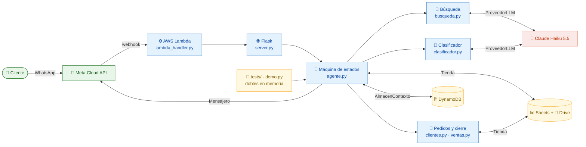
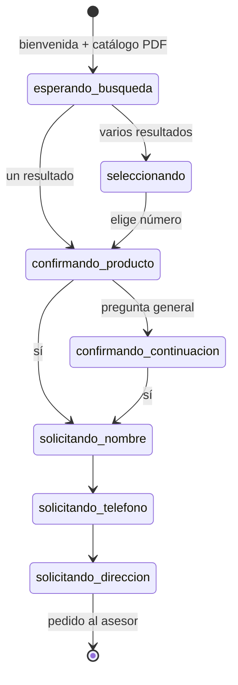
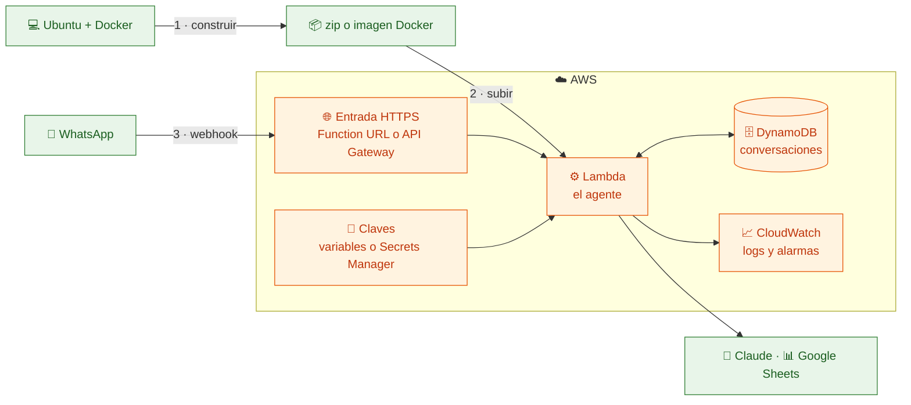

<div align="center">

# 🛵 Agente de Ventas por WhatsApp con IA

**Agente conversacional que vende por WhatsApp: encuentra productos en el inventario aunque el cliente no use el nombre exacto, muestra fotos y precios, resuelve dudas del negocio, toma el pedido y deja que el asesor cierre la venta desde el mismo chat.**


[Planeación](docs/PLANEACION.md) · [Contexto](docs/CONTEXTO.md) · [Arquitectura](docs/ARQUITECTURA.md) · [Despliegue AWS](docs/DESPLIEGUE-AWS-LAMBDA.md) · [Proceso de venta](src/agente_vendedor/knowledge/proceso-ventas.md) · [Conocimiento del negocio](src/agente_vendedor/knowledge/negocio.md)

</div>

---

## ✨ Qué hace

| | Característica | Detalle |
|:-:|---|---|
| 🔎 | **Búsqueda semántica** | "algo para proteger la cabeza" → cascos; "retrovisor" → espejos. Primero coincidencia difusa (tolera errores de tipeo) y, si no hay resultados, Claude sugiere productos **reales** del catálogo. |
| 📦 | **Stock en tiempo real** | Lee el inventario de Google Sheets (con caché) y solo ofrece productos con unidades. |
| 🖼️ | **Fotos y videos** | Envía las imágenes y videos del producto desde Google Drive antes de la ficha con precio. |
| 💬 | **Dudas del negocio** | Horarios, envíos, garantía, tallas… se responden con el [documento de entrenamiento](src/agente_vendedor/knowledge/negocio.md); luego ofrece retomar la compra. |
| 📝 | **Captura del pedido** | Nombre, celular (validado para Colombia) y dirección; el pedido queda *pendiente* y le llega al asesor con un código. |
| 🔐 | **Cierre por el asesor** | `cerrar venta` → código → cantidad: descuenta inventario, calcula el total y evita cerrar dos veces. |
| 🛡️ | **Reglas deterministas** | Stock, precios y validaciones son código ([RV1–RV9](src/agente_vendedor/knowledge/proceso-ventas.md#reglas-de-negocio)); el modelo nunca inventa productos ni precios. |
| 🔌 | **Arquitectura desacoplada** | LLM, WhatsApp, contexto y tienda detrás de interfaces: cambiar Claude ↔ OpenAI es una variable de entorno. |
| 💰 | **Bajo costo** | ~**USD 0,0008** por conversación completa con Claude Haiku 5.5 (medido). |

---

## 🏗️ Arquitectura



**Principio de diseño:** el modelo clasifica, redacta y sugiere; **la lógica de negocio vive en el código**. Por eso `demo.py` y los tests recorren conversaciones completas sin ningún servicio externo.

Más diagramas (capas, recorrido de un mensaje, estados, ciclo de una venta, despliegue) en **[docs/ARQUITECTURA.md](docs/ARQUITECTURA.md)**.

### 🔄 Estados de la conversación



---

## 📁 Estructura

```
.
├── src/agente_vendedor/
│   ├── agente.py              # máquina de estados de la conversación
│   ├── server.py              # webhook Flask (verificación + mensajes)
│   ├── lambda_handler.py      # entrada de AWS Lambda (Mangum)
│   ├── config.py · dependencias.py
│   ├── busqueda.py            # búsqueda difusa + sugerencias del LLM
│   ├── clasificador.py        # pregunta general vs. búsqueda, y respuestas
│   ├── inventario.py          # stock, formatos de mensaje, archivos de Drive
│   ├── clientes.py · ventas.py  # captura del pedido y cierre de venta
│   ├── marketplace.py         # enlaces de Facebook Marketplace
│   ├── prompts/               # clasificador.md · respuesta.md
│   ├── knowledge/             # negocio.md · proceso-ventas.md
│   ├── llm/                   # ProveedorLLM: anthropic · openai · falso
│   ├── whatsapp/              # Mensajero: cloud_api · memoria
│   ├── contexto/              # AlmacenContexto: dynamodb · memoria
│   └── tienda/                # Tienda: google · memoria
├── .claude/skills/            # skills para Claude Code (desarrollo y negocio)
├── docs/                      # PLANEACION · CONTEXTO · ARQUITECTURA · DESPLIEGUE-AWS-LAMBDA
├── Dockerfile                 # imagen para Lambda (plan de pago)
├── tests/                     # 180 tests, sin red ni claves
├── fixtures/                  # inventario, Drive y webhooks de ejemplo
├── scripts/                   # empaquetar_lambda · env_a_aws · verificar_config · generar_skill
└── demo.py                    # conversación en consola
```

---

## 🚀 Inicio rápido

> Requiere **Python 3.11+**.

```bash
python -m venv .venv
.venv\Scripts\activate            # Windows  (Linux/Mac: source .venv/bin/activate)
pip install -r requirements-dev.txt
cp .env.example .env              # completar ANTHROPIC_API_KEY y demás valores
```

### 🧪 Tests (no requieren claves)

```bash
pytest            # 180 tests
pytest --cov      # con cobertura
```

### 💬 Demo en consola

Usa el inventario de `fixtures/`. Con `ANTHROPIC_API_KEY` en `.env` conversa con Claude real; sin ella, con un LLM simulado.

```bash
python demo.py --guion    # compra completa + cierre de venta
python demo.py            # interactivo ("!texto" para hablar como asesor)
```

### 🔍 Verificar configuración

```bash
python scripts/verificar_config.py            # variables, credenciales, prompts
python scripts/verificar_config.py --online   # además se conecta a Google Sheets/Drive
```

---

## ☁️ Producción en AWS

El agente corre **sin servidores que administrar**: AWS Lambda lo ejecuta solo cuando llega un mensaje de WhatsApp y cobra únicamente por ese tiempo. Hay dos formas de desplegarlo, según el volumen:



| Herramienta de AWS | Para qué se usa | 🆓 Plan gratuito | 💳 Plan de pago |
|---|---|:-:|:-:|
| **Lambda** | Ejecuta el agente con cada mensaje | ✅ zip | ✅ imagen Docker |
| **Function URL** | Dirección HTTPS pública para el webhook, sin costo | ✅ | |
| **API Gateway** | Dirección HTTPS con límite de peticiones por segundo | | ✅ |
| **ECR** | Guarda las imágenes Docker y sus versiones | | ✅ |
| **DynamoDB** | Recuerda en qué paso va cada cliente (24 h) | ✅ capacidad fija | ✅ bajo demanda |
| **Secrets Manager** | Guarda las claves cifradas, fuera de la Lambda | | ✅ |
| **IAM** | Permisos mínimos: la Lambda solo accede a su tabla y su secreto | ✅ | ✅ |
| **CloudWatch** | Logs, métricas y alarma de errores | ✅ logs | ✅ logs + alarmas |
| **SNS** | Envía las alertas por correo | | ✅ |
| **Budgets** | Avisa si el gasto del mes supera un tope | ✅ | ✅ |

**¿Cuál elegir?**
- 🆓 **Plan gratuito:** USD 0 en AWS hasta ~**22.000 conversaciones al mes**. Ideal para empezar.
- 💳 **Plan de pago:** ~**USD 7 al mes** con 50.000 conversaciones, con claves en Secrets Manager, límite de peticiones y alertas.
- Se puede pasar del gratuito al de pago en cualquier momento sin perder conversaciones. El costo de Claude va aparte (~USD 0,0008 por conversación).

> 📘 **Todos los pasos y comandos** (desde Ubuntu con Docker, explicados uno por uno): **[docs/DESPLIEGUE-AWS-LAMBDA.md](docs/DESPLIEGUE-AWS-LAMBDA.md)**

---

## 🤖 Trabajar con Claude Code

El repositorio incluye dos skills en `.claude/skills/`:

| Skill | Para qué |
|---|---|
| `agente-ventas-whatsapp` | Comandos, recetas (cambiar conocimiento, agregar estados o proveedores) y reglas de desarrollo |
| `ventas-motopro` | Conocimiento del negocio y del proceso de venta; **se genera** desde `knowledge/` con `scripts/generar_skill.py` |

---

## 🧰 Stack tecnológico

| Capa | Tecnología | Uso |
|---|---|---|
| **Runtime** |   | Función sin servidor detrás del webhook |
| **Web** |  | Webhook de WhatsApp, adaptado a Lambda con Mangum |
| **IA** |  | Clasificación, respuestas del negocio y búsqueda semántica (OpenAI como alternativa) |
| **Mensajería** |  | Texto, imágenes, videos y documentos |
| **Datos** |   | Inventario, registro de ventas, fotos y catálogo |
| **Estado** |  | Contexto de cada conversación con expiración de 24 h |
| **Búsqueda** | fuzzywuzzy + Levenshtein | Coincidencia difusa de nombres de producto |
| **Tests** |  | Unitarios y conversaciones completas |

---

<div align="center">

Hecho por **Anderson Sarmiento Briceño**

</div>
