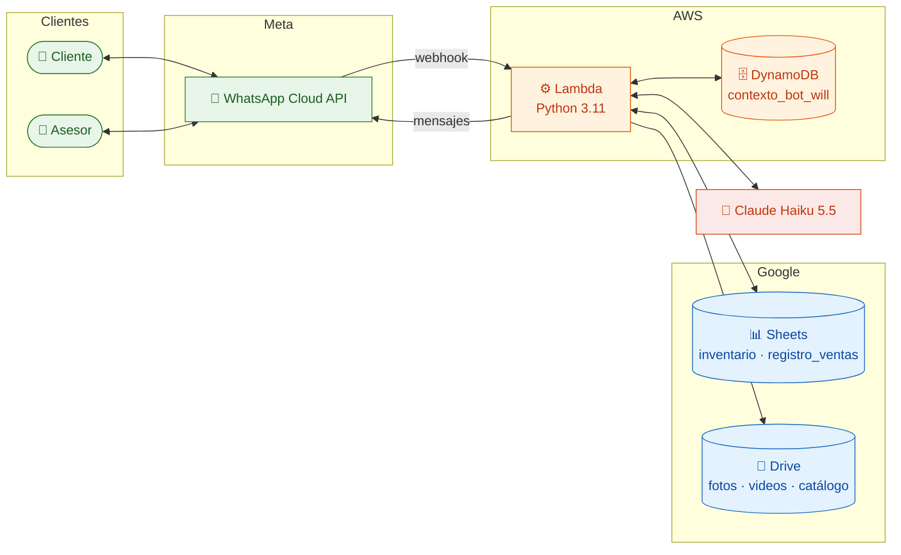
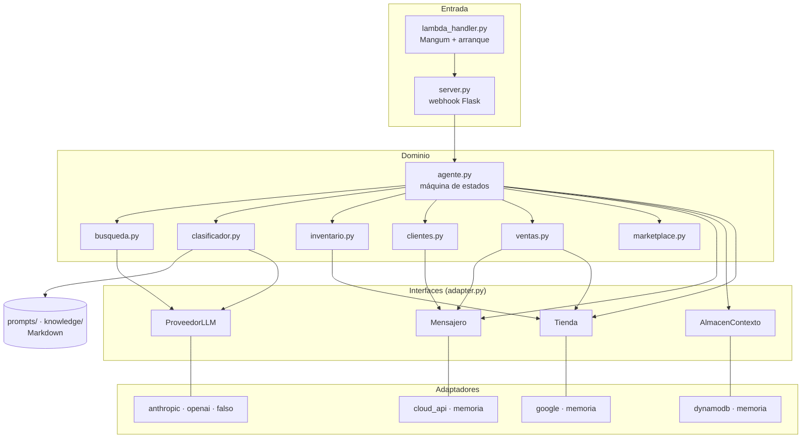
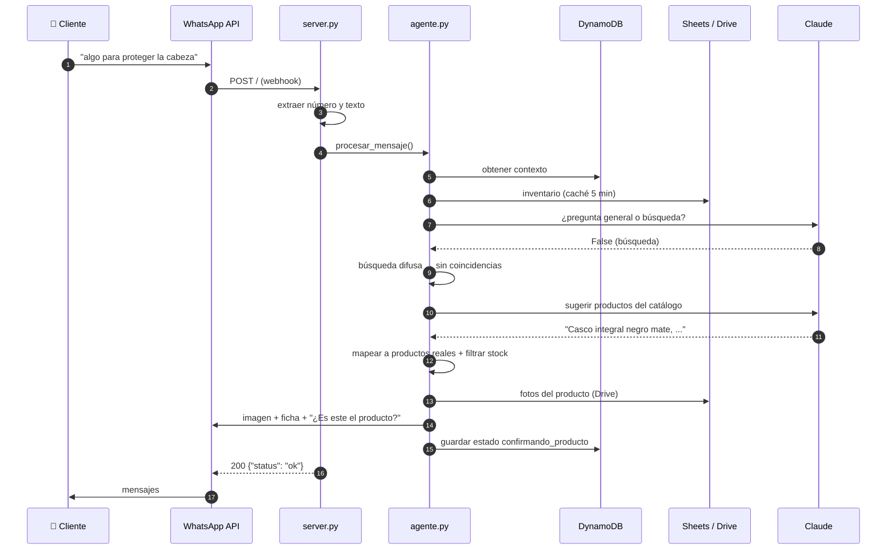
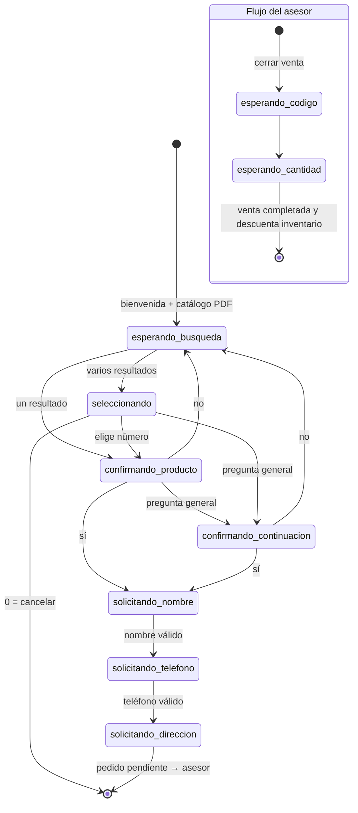
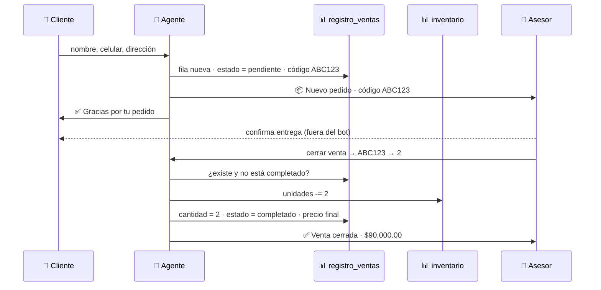
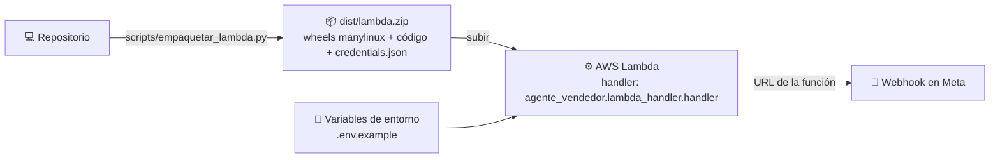

# Arquitectura

## 1. Vista general

## 2. Capas del código

**Regla de dependencias:** el dominio solo conoce las interfaces. `dependencias.py` arma el objeto `Dependencias` con los adaptadores reales (producción) o en memoria (tests y `demo.py`).

## 3. Recorrido de un mensaje

## 4. Estados de la conversación

## 5. Ciclo de vida de una venta

## 6. Datos

| Almacén | Clave | Contenido |
|---|---|---|
| DynamoDB `contexto_bot_will` | `whatsapp_number` | `context` (JSON con `estado_usuarios_data` y `codigos_venta_data`) y `expire_at` (TTL 24 h) |
| Sheets `inventario` | fila | `numero` · `servicio` · `unidades` · `precio` · `descripcion` |
| Sheets `registro_ventas` | fila | Fecha · Nombre · Teléfono · Dirección · Producto · CódigoProducto · Cantidad · Asesor · CódigoVenta · estado · PrecioFinal |
| Drive (carpeta) | nombre de archivo | `GPMR01-frente.jpg`, `GPMR01-video.mp4`… y el PDF del catálogo (el más reciente) |

## 7. Despliegue

