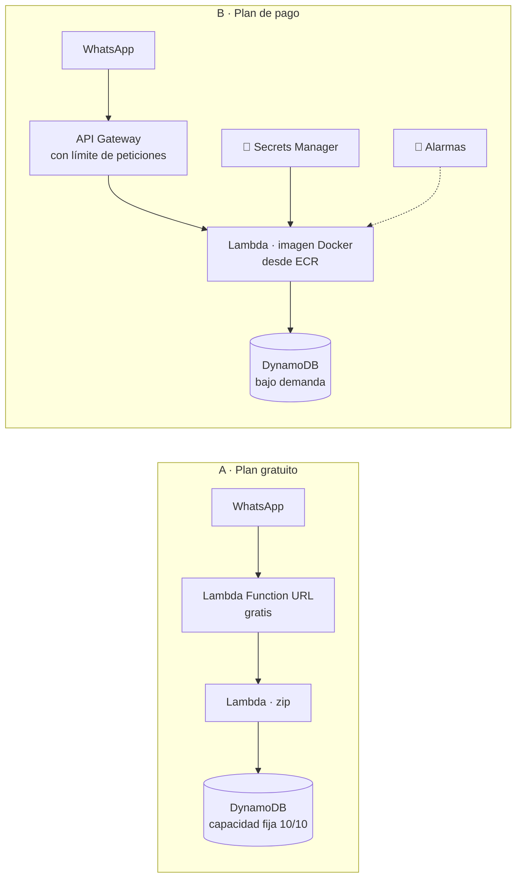

# Despliegue en AWS Lambda

> Guía paso a paso para publicar el agente en AWS **desde una terminal de Ubuntu con Docker Desktop**.
> Hay dos soluciones: **A. Plan gratuito** (para empezar, cuesta USD 0 en AWS) y **B. Plan de pago** (más segura y escalable, para cuando se pasen los límites gratuitos).
> Cada comando tiene un comentario `#` que explica qué hace. Copia y pega en orden.

---

## Índice
1. [¿Qué solución elijo?](#1-qué-solución-elijo)
2. [¿Cuántas conversaciones caben gratis?](#2-cuántas-conversaciones-caben-gratis)
3. [Preparar Ubuntu (una sola vez)](#3-preparar-ubuntu-una-sola-vez)
4. [Solución A: Plan gratuito](#4-solución-a-plan-gratuito)
5. [Solución B: Plan de pago](#5-solución-b-plan-de-pago)
6. [Conectar el webhook de WhatsApp](#6-conectar-el-webhook-de-whatsapp)
7. [Operación diaria: logs, actualizar y volver atrás](#7-operación-diaria-logs-actualizar-y-volver-atrás)
8. [Problemas frecuentes](#8-problemas-frecuentes)
9. [Borrar todo](#9-borrar-todo)

---

## 1. ¿Qué solución elijo?



| | **A. Plan gratuito** | **B. Plan de pago** |
|---|---|---|
| Para quién | Empezar, tienda pequeña | Cuando crece el volumen o se necesita más control |
| Costo AWS | **USD 0** dentro de los límites gratuitos | ~USD 5–10/mes a 50.000 conversaciones (ver §5.0) |
| Cómo se sube el código | Archivo `.zip` (28 MB) | Imagen Docker en ECR |
| Entrada del webhook | Function URL (gratis) | API Gateway (con límite de peticiones por segundo) |
| Claves | Variables de entorno de la Lambda (cifradas por AWS) | **Secrets Manager** (no se ven en la consola de Lambda) |
| DynamoDB | Capacidad fija: gratis, pero puede saturarse con picos | Bajo demanda: aguanta picos y cobra por uso |
| Alertas | Presupuesto mensual | Presupuesto + alarma de errores por correo |
| Pasar de A a B | — | Se puede en cualquier momento sin perder conversaciones |

> 💡 **El costo de Claude va aparte** (se paga en console.anthropic.com): ~USD 0,0008 por conversación en ambas soluciones.

---

## 2. ¿Cuántas conversaciones caben gratis?

AWS tiene servicios **"siempre gratis"** que no vencen, incluso en cuentas de pago:

| Servicio | Límite gratuito mensual | Lo que usa el agente |
|---|---|---|
| **Lambda** | 1.000.000 de invocaciones y 400.000 GB-segundos | Cada mensaje del cliente **y** cada aviso de estado de WhatsApp |
| **DynamoDB** | 25 GB y 25 unidades de lectura + 25 de escritura (capacidad fija) | 1 lectura y 1 escritura por mensaje |
| **CloudWatch Logs** | 5 GB de logs | Unas líneas por mensaje |
| **Function URL** | Sin costo adicional | La dirección del webhook |

### ¿Por qué cada conversación gasta ~45 invocaciones?
WhatsApp no solo avisa cuando el cliente escribe: también avisa cuando cada mensaje del bot fue **enviado, entregado y leído**. Una conversación típica (saludo, búsqueda, una pregunta y el pedido) tiene ~8 mensajes del cliente y ~12 del bot:

```
8 mensajes del cliente           →  8 invocaciones de ~2,5 s (consultan Sheets y Claude)
12 mensajes del bot × 3 avisos   → 36 invocaciones de ~0,05 s (se responden "ok" al instante)
                                   ──
                                   ~45 invocaciones y ~11 GB-segundos (con 512 MB de memoria)
```

### Resultado
| Límite | Cálculo | Conversaciones al mes |
|---|---|---|
| Invocaciones | 1.000.000 ÷ 45 | ~22.000 |
| Cómputo | 400.000 GB-s ÷ 11 | ~36.000 |
| **Lo que se acaba primero** | | **~22.000 conversaciones/mes (~700 al día)** |

> ⚠️ Son estimaciones con supuestos razonables. Mide las tuyas en **CloudWatch → Métricas → Lambda** después de unos días.
>
> ⚠️ **Cuentas nuevas (creadas desde julio de 2025):** AWS pide elegir entre *Plan gratuito* (créditos por 6 meses) y *Plan de pago*. Los límites "siempre gratis" de la tabla aplican en ambos, pero el *Plan gratuito* cierra la cuenta al terminar los 6 meses si no la actualizas. Revísalo en **Billing → Free Tier** y en https://aws.amazon.com/free.

---

## 3. Preparar Ubuntu (una sola vez)

### 3.1 Instalar herramientas
```bash
# Paquetes básicos: git, curl, unzip y Python (para los scripts del proyecto)
sudo apt update && sudo apt install -y git curl unzip python3 python3-venv

# AWS CLI v2 (la herramienta de línea de comandos de AWS)
curl "https://awscli.amazonaws.com/awscli-exe-linux-x86_64.zip" -o /tmp/awscliv2.zip
unzip -q /tmp/awscliv2.zip -d /tmp && sudo /tmp/aws/install
aws --version                                   # debe mostrar aws-cli/2.x

# Docker Desktop ya debe estar instalado y abierto
docker --version && docker info --format '{{.OSType}}'   # debe decir "linux"
```

### 3.2 Crear un usuario de AWS para desplegar
No uses el usuario raíz (el correo con el que abriste la cuenta). En la **consola web de AWS**:
1. **IAM → Usuarios → Crear usuario** → nombre `despliegue`.
2. Permisos: **Adjuntar políticas directamente** → `AdministratorAccess` (solo para este usuario de despliegue).
3. Abre el usuario → **Credenciales de seguridad → Crear clave de acceso** → *Interfaz de línea de comandos (CLI)*. Copia el *Access key* y el *Secret*.

```bash
# Guarda las credenciales en Ubuntu (~/.aws/credentials). Región: us-east-1, formato: json
aws configure

# Comprueba que funciona: muestra tu número de cuenta
aws sts get-caller-identity
```

### 3.3 Descargar el proyecto y traer los secretos
```bash
# Clonar el repositorio
git clone https://github.com/anderson-sarmiento-briceno/agente-ventas-whatsapp-ia.git
cd agente-ventas-whatsapp-ia
```

`.env` y `credentials.json` **no están en GitHub** (son secretos). Cópialos desde tu PC de Windows a esta carpeta (por USB, `scp` o tu gestor de contraseñas) y luego:

```bash
# Que solo tu usuario pueda leerlos
chmod 600 .env credentials.json

# Revisa que el .env tenga todo (debe terminar con "0 errores")
python3 scripts/verificar_config.py
```

### 3.4 Variables de la terminal
Estas variables se usan en todos los comandos siguientes. **Si cierras la terminal, vuelve a ejecutarlas.**
```bash
export AWS_DEFAULT_REGION=us-east-1             # región de AWS (la más barata y cercana a Colombia con todos los servicios)
export REGION=$AWS_DEFAULT_REGION
export CUENTA=$(aws sts get-caller-identity --query Account --output text)   # tu número de cuenta
export FUNCION=agente-ventas-whatsapp            # nombre de la Lambda
export TABLA=contexto_bot_will                   # tabla de DynamoDB (la misma de la versión 1)
export ROL=agente-ventas-whatsapp-rol            # permisos que usará la Lambda
export CORREO=tu-correo@ejemplo.com              # ← cambia esto: aquí llegan las alertas de costo
echo "Cuenta $CUENTA en $REGION"
```

> 🔁 **¿Ya tienes la versión 1 funcionando?** Usa **la misma región** donde está la tabla `contexto_bot_will` (`aws dynamodb list-tables --region <region>`). Esta guía crea una Lambda **nueva**: la vieja (`vendedor_asesor_will`) sigue intacta y sirve para volver atrás.
> Antes de empezar, **anota la URL actual** del webhook (Lambda → `vendedor_asesor_will` → Configuración → URL de la función): es la que pondrás en Meta si necesitas volver a la versión 1.

---

## 4. Solución A: Plan gratuito

### Paso A1 · Tabla de DynamoDB (memoria de las conversaciones)
```bash
# ¿Ya existe? (si la versión 1 la creó, salta al comando de TTL)
aws dynamodb describe-table --table-name "$TABLA" --query 'Table.TableStatus' --output text 2>/dev/null || echo "NO EXISTE"

# Crearla con capacidad fija 10 lecturas/10 escrituras: dentro de las 25 gratuitas
aws dynamodb create-table \
  --table-name "$TABLA" \
  --attribute-definitions AttributeName=whatsapp_number,AttributeType=S \
  --key-schema AttributeName=whatsapp_number,KeyType=HASH \
  --billing-mode PROVISIONED \
  --provisioned-throughput ReadCapacityUnits=10,WriteCapacityUnits=10
aws dynamodb wait table-exists --table-name "$TABLA"    # espera a que quede lista

# Borrado automático: cada conversación se olvida 24 h después (atributo expire_at). Es gratis.
aws dynamodb update-time-to-live --table-name "$TABLA" \
  --time-to-live-specification "Enabled=true,AttributeName=expire_at"
```

### Paso A2 · Rol de permisos de la Lambda
La Lambda necesita permiso para escribir logs y usar **solo** esta tabla.
```bash
# 1) Quién puede usar el rol: el servicio Lambda
cat > /tmp/confianza.json <<'EOF'
{
  "Version": "2012-10-17",
  "Statement": [{ "Effect": "Allow", "Principal": { "Service": "lambda.amazonaws.com" }, "Action": "sts:AssumeRole" }]
}
EOF
aws iam create-role --role-name "$ROL" --assume-role-policy-document file:///tmp/confianza.json

# 2) Permiso para escribir logs en CloudWatch
aws iam attach-role-policy --role-name "$ROL" \
  --policy-arn arn:aws:iam::aws:policy/service-role/AWSLambdaBasicExecutionRole

# 3) Permiso para leer, guardar y borrar en la tabla (y en nada más)
cat > /tmp/permisos.json <<EOF
{
  "Version": "2012-10-17",
  "Statement": [{
    "Effect": "Allow",
    "Action": ["dynamodb:GetItem", "dynamodb:PutItem", "dynamodb:DeleteItem"],
    "Resource": "arn:aws:dynamodb:${REGION}:${CUENTA}:table/${TABLA}"
  }]
}
EOF
aws iam put-role-policy --role-name "$ROL" --policy-name dynamodb-contexto --policy-document file:///tmp/permisos.json

sleep 10   # IAM tarda unos segundos en propagar el rol
```

### Paso A3 · Construir el paquete `.zip` con Docker
Se construye **dentro de la imagen oficial de Lambda**, así las librerías quedan exactamente para el sistema de AWS.
```bash
docker run --rm --platform linux/amd64 \
  --user "$(id -u):$(id -g)" -e HOME=/tmp \
  -v "$PWD":/app -w /app \
  --entrypoint python public.ecr.aws/lambda/python:3.11 \
  scripts/empaquetar_lambda.py
# Resultado: dist/lambda.zip (~28 MB) con el código, las librerías y credentials.json
```

### Paso A4 · Crear la Lambda
```bash
# Convierte el .env al formato de Lambda (archivo temporal con secretos)
python3 scripts/env_a_aws.py lambda > /tmp/variables.json

aws lambda create-function \
  --function-name "$FUNCION" \
  --runtime python3.11 \
  --architectures x86_64 \
  --handler agente_vendedor.lambda_handler.handler \
  --role "arn:aws:iam::${CUENTA}:role/${ROL}" \
  --zip-file fileb://dist/lambda.zip \
  --memory-size 512 \
  --timeout 30 \
  --environment file:///tmp/variables.json
#   --memory-size 512 → memoria (y CPU) de cada ejecución; 512 MB equilibra velocidad y gratuidad
#   --timeout 30      → si algo se cuelga, se corta a los 30 s

aws lambda wait function-active-v2 --function-name "$FUNCION"   # espera a que quede activa
shred -u /tmp/variables.json                                       # borra el archivo con secretos
```

### Paso A5 · Dirección pública (Function URL)
```bash
# Crea una URL https pública para la Lambda (gratis, sin API Gateway)
aws lambda create-function-url-config --function-name "$FUNCION" --auth-type NONE

# Permite que cualquiera llame a la URL (WhatsApp necesita poder entrar)
aws lambda add-permission --function-name "$FUNCION" \
  --statement-id url-publica --action lambda:InvokeFunctionUrl \
  --principal "*" --function-url-auth-type NONE

export URL=$(aws lambda get-function-url-config --function-name "$FUNCION" --query FunctionUrl --output text)
echo "Webhook: $URL"     # algo como https://abc123.lambda-url.us-east-1.on.aws/
```

### Paso A6 · Logs que no crezcan para siempre
```bash
# Guarda los logs 7 días (así no se acumulan GB)
aws logs create-log-group --log-group-name "/aws/lambda/$FUNCION" 2>/dev/null || true
aws logs put-retention-policy --log-group-name "/aws/lambda/$FUNCION" --retention-in-days 7
```

### Paso A7 · Probar
```bash
# 1) ¿Está viva? → {"modelo":"claude-haiku-5-5","ok":true}
curl -s "${URL}health"; echo

# 2) ¿Meta podrá verificar el webhook? → debe responder 12345
TOKEN=$(grep '^WHATSAPP_VERIFY_TOKEN=' .env | cut -d= -f2-)
curl -s "${URL}?hub.mode=subscribe&hub.verify_token=${TOKEN}&hub.challenge=12345"; echo

# 3) Un aviso de estado de WhatsApp (no envía mensajes a nadie) → {"status":"ok"}
curl -s -X POST "$URL" -H 'Content-Type: application/json' -d @fixtures/webhooks/estado.json; echo
```
Si los tres responden bien, sigue con **[§6 Conectar el webhook](#6-conectar-el-webhook-de-whatsapp)**.

### Paso A8 · Alerta de costo (recomendado)
Te avisa por correo si el mes pasa de USD 1 (es decir, si algo dejó de ser gratis).
```bash
cat > /tmp/presupuesto.json <<'EOF'
{ "BudgetName": "agente-ventas-mensual", "BudgetLimit": { "Amount": "1", "Unit": "USD" },
  "TimeUnit": "MONTHLY", "BudgetType": "COST" }
EOF
cat > /tmp/aviso.json <<EOF
[{ "Notification": { "NotificationType": "ACTUAL", "ComparisonOperator": "GREATER_THAN", "Threshold": 50, "ThresholdType": "PERCENTAGE" },
   "Subscribers": [{ "SubscriptionType": "EMAIL", "Address": "${CORREO}" }] }]
EOF
aws budgets create-budget --account-id "$CUENTA" \
  --budget file:///tmp/presupuesto.json --notifications-with-subscribers file:///tmp/aviso.json
```
Además, en la consola: **Billing → Preferencias de facturación → Recibir alertas de uso de la capa gratuita**.

### Límites de la Solución A
- **DynamoDB con capacidad fija:** 10 escrituras/segundo. Si llegan muchos mensajes a la vez, AWS puede frenar algunas escrituras. Para una tienda pequeña sobra; si pasa seguido, ve a la Solución B.
- **Las claves se ven** en la consola de Lambda (Configuración → Variables de entorno) para quien tenga acceso a tu cuenta de AWS.
- **Sin límite de peticiones:** si alguien abusa de la URL, cada llamada cuenta. El presupuesto del paso A8 te avisa.

---

## 5. Solución B: Plan de pago

### 5.0 ¿Cuánto cuesta?
Ejemplo con **50.000 conversaciones al mes** (~2,25 millones de invocaciones). Precios de referencia de `us-east-1`; confírmalos en https://calculator.aws.

| Servicio | Cálculo | USD/mes aprox. |
|---|---|---|
| Lambda (invocaciones) | (2,25 M − 1 M gratis) × USD 0,20 por millón | 0,25 |
| Lambda (cómputo) | (550.000 − 400.000 GB-s gratis) × USD 0,0000167 | 2,50 |
| API Gateway HTTP | 2,25 M × USD 1,00 por millón | 2,25 |
| DynamoDB bajo demanda | ~1,6 M escrituras + ~0,4 M lecturas | 1,10 |
| Secrets Manager | 1 secreto | 0,40 |
| ECR (imagen ~0,4 GB) | USD 0,10 por GB | 0,04 |
| CloudWatch (logs + 1 alarma) | Logs dentro de 5 GB gratis + alarma | 0,10 |
| **Total AWS** | | **~6,60** |
| Claude Haiku 5.5 (aparte) | 50.000 × USD 0,0008 | ~40 |

> Lo más caro es el modelo, no AWS. Los límites gratuitos de Lambda siguen aplicando en la Solución B.

### Paso B1 · Variables adicionales
Además de las del [§3.4](#34-variables-de-la-terminal):
```bash
export SECRETO=agente-ventas/prod                                   # nombre del secreto
export REPO=agente-ventas-whatsapp                                  # repositorio de imágenes en ECR
export IMAGEN="${CUENTA}.dkr.ecr.${REGION}.amazonaws.com/${REPO}"   # dirección de la imagen
export VERSION=$(git rev-parse --short HEAD)                        # versión = commit actual (para volver atrás)
```

### Paso B2 · DynamoDB bajo demanda
```bash
# Si la tabla NO existe: créala bajo demanda (paga por uso, sin límite fijo)
aws dynamodb create-table \
  --table-name "$TABLA" \
  --attribute-definitions AttributeName=whatsapp_number,AttributeType=S \
  --key-schema AttributeName=whatsapp_number,KeyType=HASH \
  --billing-mode PAY_PER_REQUEST
aws dynamodb wait table-exists --table-name "$TABLA"
aws dynamodb update-time-to-live --table-name "$TABLA" \
  --time-to-live-specification "Enabled=true,AttributeName=expire_at"

# Si la tabla YA existe (por ejemplo, vienes de la Solución A): solo cambia el modo de cobro
aws dynamodb update-table --table-name "$TABLA" --billing-mode PAY_PER_REQUEST
```

### Paso B3 · Guardar las claves en Secrets Manager
Las claves (WhatsApp, Claude, Google…) quedan cifradas en un solo secreto. La Lambda las lee al arrancar gracias a la variable `SECRETO_ID`.
```bash
# Arma el secreto desde .env + credentials.json (archivo temporal)
python3 scripts/env_a_aws.py secreto > /tmp/secreto.json

aws secretsmanager create-secret --name "$SECRETO" \
  --description "Claves del agente de ventas por WhatsApp" \
  --secret-string file:///tmp/secreto.json
shred -u /tmp/secreto.json                       # borra el archivo con secretos

# Para cambiar una clave más adelante: edita .env y ejecuta
#   python3 scripts/env_a_aws.py secreto > /tmp/secreto.json
#   aws secretsmanager put-secret-value --secret-id "$SECRETO" --secret-string file:///tmp/secreto.json
#   shred -u /tmp/secreto.json
```

### Paso B4 · Rol de permisos
Igual que el [Paso A2](#paso-a2--rol-de-permisos-de-la-lambda) (créalo si no existe) y, además, permiso para leer **solo** este secreto:
```bash
cat > /tmp/permiso-secreto.json <<EOF
{
  "Version": "2012-10-17",
  "Statement": [{
    "Effect": "Allow",
    "Action": "secretsmanager:GetSecretValue",
    "Resource": "arn:aws:secretsmanager:${REGION}:${CUENTA}:secret:${SECRETO}-*"
  }]
}
EOF
aws iam put-role-policy --role-name "$ROL" --policy-name leer-secreto --policy-document file:///tmp/permiso-secreto.json
```

### Paso B5 · Repositorio de imágenes (ECR) y subir la imagen
```bash
# 1) Crear el repositorio (revisa vulnerabilidades en cada subida)
aws ecr create-repository --repository-name "$REPO" --image-scanning-configuration scanOnPush=true

# 2) Conservar solo las últimas 5 imágenes (las viejas cuestan almacenamiento)
cat > /tmp/limpieza.json <<'EOF'
{ "rules": [{ "rulePriority": 1, "description": "Conservar las ultimas 5 imagenes",
  "selection": { "tagStatus": "any", "countType": "imageCountMoreThan", "countNumber": 5 },
  "action": { "type": "expire" } }] }
EOF
aws ecr put-lifecycle-policy --repository-name "$REPO" --lifecycle-policy-text file:///tmp/limpieza.json

# 3) Iniciar sesión de Docker en ECR (dura 12 horas)
aws ecr get-login-password | docker login --username AWS --password-stdin "${CUENTA}.dkr.ecr.${REGION}.amazonaws.com"

# 4) Construir la imagen (ver Dockerfile) y subirla
#    --platform linux/amd64 → Lambda x86_64
#    --provenance=false     → sin esto Lambda rechaza la imagen ("image manifest not supported")
docker buildx build --platform linux/amd64 --provenance=false -t "${IMAGEN}:${VERSION}" --load .
docker push "${IMAGEN}:${VERSION}"
```

> 🧪 **Probar la imagen en tu máquina antes de subirla** (opcional): la imagen trae un emulador de Lambda.
> ```bash
> docker run --rm -p 9000:8080 --env-file .env -e AWS_DEFAULT_REGION=$REGION \
>   -v "$PWD/credentials.json:/var/task/credentials.json:ro" "${IMAGEN}:${VERSION}"
> # En otra terminal: → {"statusCode": 200, "body": "{\"modelo\":\"claude-haiku-5-5\",\"ok\":true}\n", ...}
> curl -s -X POST http://localhost:9000/2015-03-31/functions/function/invocations -d @fixtures/lambda/evento_health.json
> ```

### Paso B6 · Crear la Lambda desde la imagen
```bash
# Variables NO sensibles + SECRETO_ID (las claves vienen de Secrets Manager)
python3 scripts/env_a_aws.py lambda --sin-secretos --secreto-id "$SECRETO" > /tmp/variables.json

aws lambda create-function \
  --function-name "$FUNCION" \
  --package-type Image \
  --code ImageUri="${IMAGEN}:${VERSION}" \
  --architectures x86_64 \
  --role "arn:aws:iam::${CUENTA}:role/${ROL}" \
  --memory-size 512 \
  --timeout 30 \
  --environment file:///tmp/variables.json
aws lambda wait function-active-v2 --function-name "$FUNCION"
rm -f /tmp/variables.json

# Máximo 10 ejecuciones al mismo tiempo: protege el costo y las cuotas de Google Sheets
aws lambda put-function-concurrency --function-name "$FUNCION" --reserved-concurrent-executions 10
```
> Si el último comando falla con *"unreserved concurrency"*: tu cuenta tiene un límite total de 10 (común en cuentas nuevas). Omítelo o pide aumento en **Service Quotas → AWS Lambda → Concurrent executions**.

> 🔁 **¿Vienes de la Solución A?** La Lambda ya existe con zip y no se puede convertir a imagen. Usa otro nombre (`export FUNCION=agente-ventas-whatsapp-v2`), crea la nueva y cambia el webhook en Meta (§6). Luego borra la vieja.

### Paso B7 · API Gateway (entrada con límite de peticiones)
```bash
# Crea una API HTTP que envía todo a la Lambda (crea la etapa $default con despliegue automático)
export API_ID=$(aws apigatewayv2 create-api \
  --name "${FUNCION}-api" --protocol-type HTTP \
  --target "arn:aws:lambda:${REGION}:${CUENTA}:function:${FUNCION}" \
  --query ApiId --output text)

# Permite que esta API (y solo esta) invoque la Lambda
aws lambda add-permission --function-name "$FUNCION" \
  --statement-id api-gateway --action lambda:InvokeFunction \
  --principal apigateway.amazonaws.com \
  --source-arn "arn:aws:execute-api:${REGION}:${CUENTA}:${API_ID}/*"

# Límite: 20 peticiones/segundo sostenidas, picos de 50. Lo que pase de ahí se rechaza sin costo de Lambda
aws apigatewayv2 update-stage --api-id "$API_ID" --stage-name '$default' \
  --default-route-settings ThrottlingBurstLimit=50,ThrottlingRateLimit=20

export URL="$(aws apigatewayv2 get-api --api-id "$API_ID" --query ApiEndpoint --output text)/"
echo "Webhook: $URL"     # algo como https://abc123.execute-api.us-east-1.amazonaws.com/
```

### Paso B8 · Logs, alarma de errores y presupuesto
```bash
# Logs por 14 días
aws logs create-log-group --log-group-name "/aws/lambda/$FUNCION" 2>/dev/null || true
aws logs put-retention-policy --log-group-name "/aws/lambda/$FUNCION" --retention-in-days 14

# Tema de notificaciones por correo (revisa tu correo y CONFIRMA la suscripción)
export ALERTAS=$(aws sns create-topic --name agente-ventas-alertas --query TopicArn --output text)
aws sns subscribe --topic-arn "$ALERTAS" --protocol email --notification-endpoint "$CORREO"

# Alarma: 5 o más errores de la Lambda en 5 minutos (arranque fallido, timeouts...)
aws cloudwatch put-metric-alarm --alarm-name "${FUNCION}-errores" \
  --namespace AWS/Lambda --metric-name Errors \
  --dimensions Name=FunctionName,Value="$FUNCION" \
  --statistic Sum --period 300 --evaluation-periods 1 \
  --threshold 5 --comparison-operator GreaterThanOrEqualToThreshold \
  --treat-missing-data notBreaching --alarm-actions "$ALERTAS"

# Presupuesto mensual de USD 20: aviso por correo al pasar el 80 %
cat > /tmp/presupuesto20.json <<'EOF'
{ "BudgetName": "agente-ventas-mensual", "BudgetLimit": { "Amount": "20", "Unit": "USD" },
  "TimeUnit": "MONTHLY", "BudgetType": "COST" }
EOF
cat > /tmp/aviso.json <<EOF
[{ "Notification": { "NotificationType": "ACTUAL", "ComparisonOperator": "GREATER_THAN", "Threshold": 80, "ThresholdType": "PERCENTAGE" },
   "Subscribers": [{ "SubscriptionType": "EMAIL", "Address": "${CORREO}" }] }]
EOF
aws budgets create-budget --account-id "$CUENTA" \
  --budget file:///tmp/presupuesto20.json --notifications-with-subscribers file:///tmp/aviso.json
```
> Si ya creaste el presupuesto en la Solución A, cámbialo en la consola (**Billing → Budgets**) en lugar de crear otro.

### Paso B9 · Probar
Los mismos tres `curl` del [Paso A7](#paso-a7--probar) con la nueva `$URL`.

---

## 6. Conectar el webhook de WhatsApp
En https://developers.facebook.com → tu app → **WhatsApp → Configuración → Webhook**:

1. **Editar** → *URL de devolución de llamada*: pega el valor de `echo $URL`.
2. *Token de verificación*: el valor de `WHATSAPP_VERIFY_TOKEN` de tu `.env`.
3. **Verificar y guardar.** Meta llama a la URL con `hub.challenge`; si la Lambda responde bien, se guarda.
4. En **Campos del webhook**, suscríbete a **`messages`**.
5. Escribe al número de WhatsApp del negocio: debe llegar la bienvenida y el catálogo.

> 🔁 **Volver a la versión 1** en cualquier momento: pon de nuevo la URL de la Lambda vieja en este mismo formulario.

---

## 7. Operación diaria: logs, actualizar y volver atrás

### Ver qué está pasando
```bash
# Logs en vivo (Ctrl+C para salir)
aws logs tail "/aws/lambda/$FUNCION" --follow

# Solo errores de la última hora
aws logs tail "/aws/lambda/$FUNCION" --since 1h --filter-pattern "ERROR"
```

### Publicar una nueva versión del código
```bash
git pull                                   # trae los cambios
python3 -m venv .venv && .venv/bin/pip install -q -r requirements-dev.txt && .venv/bin/python -m pytest -q   # ¿pasan los tests?
```
**Solución A (zip):**
```bash
docker run --rm --platform linux/amd64 --user "$(id -u):$(id -g)" -e HOME=/tmp -v "$PWD":/app -w /app \
  --entrypoint python public.ecr.aws/lambda/python:3.11 scripts/empaquetar_lambda.py
aws lambda update-function-code --function-name "$FUNCION" --zip-file fileb://dist/lambda.zip
aws lambda wait function-updated-v2 --function-name "$FUNCION"
```
**Solución B (imagen):**
```bash
export VERSION=$(git rev-parse --short HEAD)
aws ecr get-login-password | docker login --username AWS --password-stdin "${CUENTA}.dkr.ecr.${REGION}.amazonaws.com"
docker buildx build --platform linux/amd64 --provenance=false -t "${IMAGEN}:${VERSION}" --load . && docker push "${IMAGEN}:${VERSION}"
aws lambda update-function-code --function-name "$FUNCION" --image-uri "${IMAGEN}:${VERSION}"
aws lambda wait function-updated-v2 --function-name "$FUNCION"
```

### Cambiar una variable (ej. `ASESORES_AUTORIZADOS`)
Edita `.env` y:
```bash
# Solución A
python3 scripts/env_a_aws.py lambda > /tmp/variables.json
# Solución B (las claves se cambian en el secreto, ver Paso B3)
python3 scripts/env_a_aws.py lambda --sin-secretos --secreto-id "$SECRETO" > /tmp/variables.json

aws lambda update-function-configuration --function-name "$FUNCION" --environment file:///tmp/variables.json
shred -u /tmp/variables.json
```

### Volver a una versión anterior (Solución B)
```bash
aws ecr list-images --repository-name "$REPO" --query 'imageIds[].imageTag' --output table   # versiones disponibles
aws lambda update-function-code --function-name "$FUNCION" --image-uri "${IMAGEN}:<version-anterior>"
```
En la Solución A: `git checkout <commit-anterior>`, vuelve a empaquetar y actualiza.

---

## 8. Problemas frecuentes

| Síntoma | Causa | Solución |
|---|---|---|
| `curl` a la URL devuelve **403** con `{"Message":"Forbidden"}` (Solución A) | Falta alguno de los dos permisos públicos de la URL | Repite los dos `add-permission` del Paso A5. En la consola, Configuración → URL de la función muestra un aviso azul si falta alguno. (Un 403 con el texto `Token inválido` es normal: es el bot respondiendo a una visita sin token de Meta.) |
| **502 / Internal Server Error** y en logs `Init failed` | La Lambda no pudo arrancar | `aws logs tail "/aws/lambda/$FUNCION" --since 10m`. Casi siempre es una variable faltante (`🚨 Faltan variables de entorno`) o el secreto no se pudo leer (permiso del Paso B4) |
| `NoRegionError` probando la imagen en local | Docker no tiene región | Agrega `-e AWS_DEFAULT_REGION=us-east-1` (en Lambda real AWS la pone sola) |
| Lambda rechaza la imagen: *image manifest … not supported* | Se construyó con *provenance* | Reconstruye con `--provenance=false` |
| `exec format error` | Imagen de otra arquitectura (ej. Mac M1 o ARM) | Reconstruye con `--platform linux/amd64` |
| Meta no verifica el webhook | Token distinto o URL sin `/` final | Compara `WHATSAPP_VERIFY_TOKEN` y prueba el `curl` 2 del Paso A7 |
| El bot responde dos veces el mismo mensaje | WhatsApp reintentó porque la respuesta tardó | Revisa la duración en logs (`REPORT … Duration`); pendiente en el código: descartar mensajes repetidos por su `id` |
| `ProvisionedThroughputExceededException` en logs (Solución A) | Muchos mensajes a la vez para la capacidad fija | Sube a 20/20 (`aws dynamodb update-table --table-name "$TABLA" --provisioned-throughput ReadCapacityUnits=20,WriteCapacityUnits=20`) o pasa a la Solución B |
| `Claude: ANTHROPIC_API_KEY inválida` | Clave mal copiada o revocada | Corrige `.env` y actualiza variables (A) o secreto (B) |

---

## 9. Borrar todo
Por si quieres empezar de cero o dejar de pagar. **Borrar la tabla elimina las conversaciones en curso.**
```bash
aws lambda delete-function --function-name "$FUNCION"
aws logs delete-log-group --log-group-name "/aws/lambda/$FUNCION"
aws iam delete-role-policy --role-name "$ROL" --policy-name dynamodb-contexto
aws iam delete-role-policy --role-name "$ROL" --policy-name leer-secreto 2>/dev/null || true
aws iam detach-role-policy --role-name "$ROL" --policy-arn arn:aws:iam::aws:policy/service-role/AWSLambdaBasicExecutionRole
aws iam delete-role --role-name "$ROL"
aws budgets delete-budget --account-id "$CUENTA" --budget-name agente-ventas-mensual
# Solo Solución B:
aws apigatewayv2 delete-api --api-id "$API_ID"
aws ecr delete-repository --repository-name "$REPO" --force
aws secretsmanager delete-secret --secret-id "$SECRETO" --recovery-window-in-days 7
aws cloudwatch delete-alarms --alarm-names "${FUNCION}-errores"
aws sns delete-topic --topic-arn "$ALERTAS"
# La tabla (cuidado: compartida con la versión 1)
# aws dynamodb delete-table --table-name "$TABLA"
```

---

## Seguridad: lo que conviene saber
- **Nunca** subas `.env` ni `credentials.json` a GitHub; el `.gitignore` y el `.dockerignore` ya los excluyen.
- La URL del webhook es pública. Hoy el agente no verifica la firma `X-Hub-Signature-256` que manda Meta; agregarla (con el *App Secret* de la app de Meta) evita que alguien envíe mensajes falsos. Es la siguiente mejora de seguridad recomendada.
- Rota el token de WhatsApp y la clave de OpenAI de la versión 1: estuvieron escritos en el código.
- El usuario `despliegue` tiene permisos de administrador: guarda sus claves solo en tu máquina y desactívalas si no las usas.
